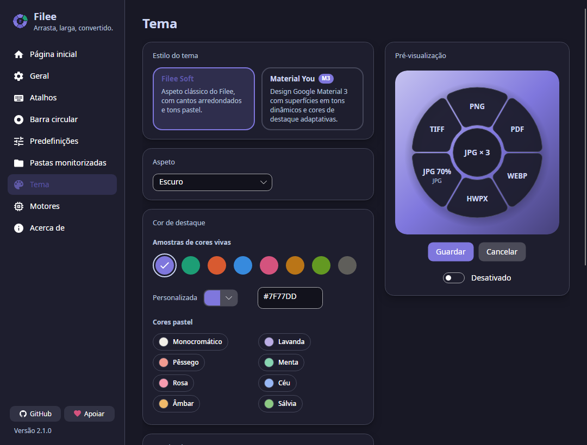
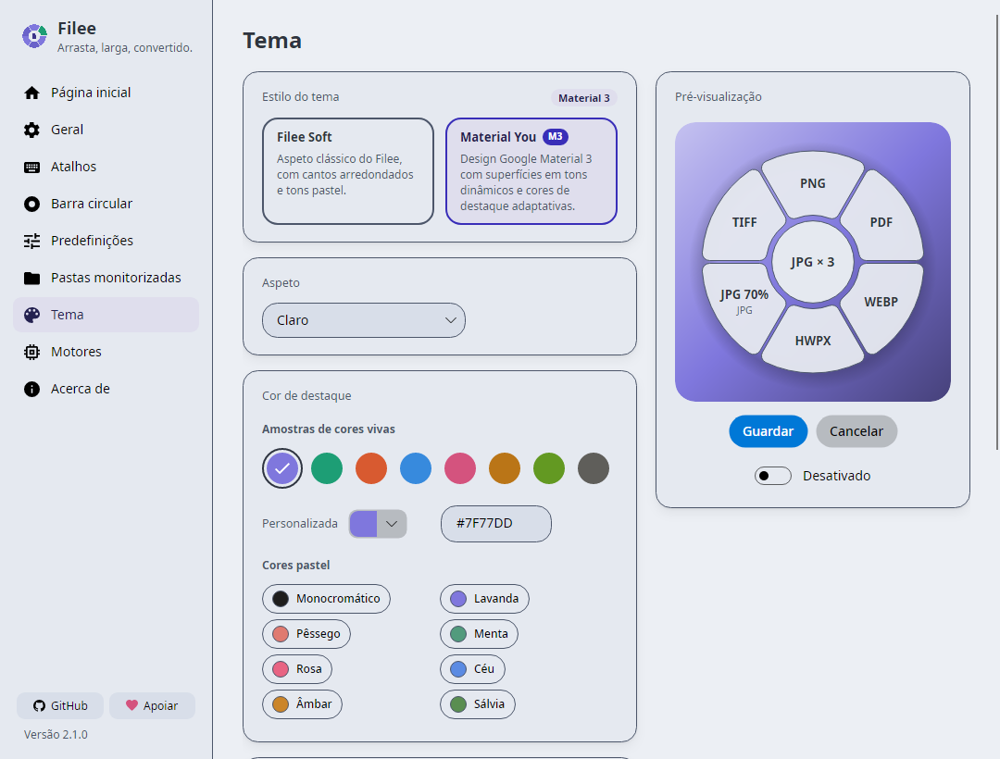

# Proposal: optional named colour palettes

Status: **proposal and review examples only**. The application, settings schema and language catalogs are unchanged. Based on main `1bf94e71` (Filee 2.1.0).

Filee already supports nine surface/text/status colours through [`theme.json`](../../docs/CUSTOM-THEMES.md). The proposal is to make a small set of those palettes available in **Settings → Theme**, alongside the existing Filee appearance.

## Suggested interaction

Add one compact **Colour palette** drop-down below the light/dark selector:

```text
Theme style      Filee Soft / Material You
Appearance       System / Light / Dark
Colour palette   Filee (original) / Catppuccin / Nord / Dracula / Monokai
Accent colour    existing controls
```

Keep **Filee (original)** as the default for both existing and new installations. A new, optional `ColorSchemeKey` would identify the surface palette; the current `PresetKey` continues to identify an accent preset. Changing palette would retain the user's accent, style, rounding and motion choices. Unknown palette IDs would fall back to Filee.

Apply the bundled palette first, then overlay the user's existing `theme.json`, preserving its current precedence and never rewriting that file. Choosing Filee restores the built-in base; an external override still applies. If an override exists, the palette control should say so and show the file location.

## Initial set

| Palette | Light | Dark | Source |
| --- | --- | --- | --- |
| Catppuccin | Latte | Mocha | [Official palette](https://github.com/catppuccin/palette) |
| Nord | Snow Storm-based mapping | Polar Night-based mapping | [Official roles and colours](https://www.nordtheme.com/docs/colors-and-palettes/) |
| Dracula | Alucard Classic | Dracula Classic | [Official specification](https://draculatheme.com/spec) |
| Monokai | Filee original fallback | Classic | [VS Code's MIT-licensed Monokai implementation](https://github.com/microsoft/vscode/tree/main/extensions/theme-monokai) |

These are application-specific mappings, not official ports or pixel-identical editor themes. Monokai uses the classic palette from VS Code; it does not use Monokai Pro assets. Its light-mode fallback must be visible in the UI, including when System changes to light.

The examples keep Filee's existing accent `#7F77DD` so the surface changes can be compared consistently. Automatic theme-specific accents are a separate design decision, not part of these examples.

## Previews from the existing application

Captured from real Avalonia/Skia windows, in headless mode, with pt-PT, 1080 × 820, reduced motion and an isolated profile. No palette picker has been added to the application. The images demonstrate today's `theme.json` mechanism.

| Palette | Filee Soft | Material You |
| --- | --- | --- |
| Filee original | [Light](previews/proposal-filee-Light-Soft.png) · [Dark](previews/proposal-filee-Dark-Soft.png) | [Light](previews/proposal-filee-Light-MaterialYou.png) · [Dark](previews/proposal-filee-Dark-MaterialYou.png) |
| Catppuccin | [Latte](previews/proposal-catppuccin-Light-Soft.png) · [Mocha](previews/proposal-catppuccin-Dark-Soft.png) | [Latte](previews/proposal-catppuccin-Light-MaterialYou.png) · [Mocha](previews/proposal-catppuccin-Dark-MaterialYou.png) |
| Nord | [Light](previews/proposal-nord-Light-Soft.png) · [Dark](previews/proposal-nord-Dark-Soft.png) | [Light](previews/proposal-nord-Light-MaterialYou.png) · [Dark](previews/proposal-nord-Dark-MaterialYou.png) |
| Dracula | [Alucard](previews/proposal-dracula-Light-Soft.png) · [Dracula](previews/proposal-dracula-Dark-Soft.png) | [Alucard](previews/proposal-dracula-Light-MaterialYou.png) · [Dracula](previews/proposal-dracula-Dark-MaterialYou.png) |
| Monokai | [Light fallback](previews/proposal-monokai-Light-Soft.png) · [Classic](previews/proposal-monokai-Dark-Soft.png) | [Light fallback](previews/proposal-monokai-Light-MaterialYou.png) · [Classic](previews/proposal-monokai-Dark-MaterialYou.png) |





Soft's Fluent text boxes, lists, menus and plain buttons retain their native light/dark appearance. Material You uses generated tonal roles as well as the nine overrides. A named palette should not promise that every control is recoloured. The screenshots also retain existing accent-derived selection labels; those need contrast review before integrating a picker.

## Checks completed

- Four loadable example files, seven custom variants, each well below the existing 64 KiB limit.
- **20 passing render/contract cases**, covering five choices × two modes × two styles. Each custom file was read with the actual `CustomTheme.Load`, all nine resolved brush colours were checked, and removing the override restored the original brushes. Source files remained unchanged. Material You's window class was checked explicitly.
- **105 colour-pair checks**, covering normal text, secondary text and three status foregrounds on each of three backgrounds, across all seven custom variants. Minimum computed contrast: **4.5106:1**, using unrounded ratios for the threshold comparison.
- **17 documented foreground adjustments** in [`contrast.json`](contrast.json) preserve legibility where editor palette colours would be too faint on application surfaces. They blend toward white/black in 1% steps until every tested background reaches 4.5:1. Original and adapted values are recorded; these adjustments are not represented as upstream palette colours.
- Windows/.NET 10 Release App/test build: zero errors, seven existing warnings in unchanged files. Final incremental rebuild: zero warnings/errors.

The ratio target follows [WCAG's normal-text contrast guidance](https://www.w3.org/WAI/WCAG22/Understanding/contrast-minimum.html). These checks do **not** certify the whole application: accent-derived text, control states, borders, focus, transparency, scaling and platform controls need review. Headless captures do not validate screen readers or native desktop interaction.

## Scope if accepted

1. Agree on the picker versus documentation/examples alone, the initial palette list and the Monokai fallback.
2. Add the palette registry and settings field, preserving accent settings and external overrides. Add only the UI strings needed for this picker to every existing language.
3. Test switching in an open window, System-mode changes, persistence, unknown IDs, partial overrides and restoration to Filee. Review actual control/focus contrast in both styles.
4. Verify keyboard operation and representative native Windows/Linux/macOS sessions before presenting this as complete.

There are no changes here to conversion logic, CLI localization or the existing accent preset UI. Existing UI/accessibility work such as #363 and #524 remains separate.

## Reproducing the examples

`python proposals/theme-palettes/build-palettes.py` regenerates the four files and contrast report. It downloads only missing, pinned source files listed in [`sources.json`](sources.json) and verifies their SHA-256 hashes. The [license notices](licenses) accompany the examples; these are palette data, not new runtime packages.

For captures, copy [`ThemeProposalRenderTests.cs`](ThemeProposalRenderTests.cs) into `tests/Filee.App.Tests/` in a **temporary source copy**, then run:

```powershell
dotnet restore Filee.slnx
dotnet build tests/Filee.App.Tests -c Release --no-restore -m:1 -p:UseSharedCompilation=false
$env:FILEE_PROPOSAL_ROOT = Join-Path (Get-Location) 'proposals/theme-palettes'
$env:FILEE_DATA_DIR = Join-Path (Get-Location) 'isolated-test-profile'
dotnet test tests/Filee.App.Tests -c Release --no-build --no-restore --filter FullyQualifiedName~ThemeProposalRenderTests
```

Captures are written to the existing test screenshot directory. This auxiliary harness is not included in the shipped projects or normal test suite.
